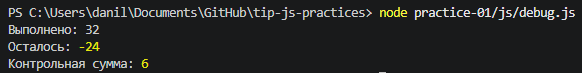

# Практическая работа № 1

## Автор и вариант
- Имя: Иван Иванов
- Группа: ПИ-21-1
- Вариант: 1 (`totalTasks = 12`, `completedTasks = 5`, `dailyLimit = 3`)

## Окружение
- ОС: Windows 11 / macOS / Linux (указать своё)
- Node.js: v24.x.x
- npm: x.x.x
- Git: x.x.x
- Браузер: Chrome (или Edge) vXX

## Запуск
Из корня репозитория:

    node practice-01/js/hello.js
    node practice-01/js/types.js
    node practice-01/js/progress.js
    node practice-01/js/plan.js
    node practice-01/js/debug.js

В браузере: открыть `practice-01/index.html`, изменить `src` в `index.html`
на нужный файл, сохранить, перезагрузить страницу и открыть Console.

## Задание 1
В Node.js последняя строка выводит `Тип document: undefined`, в браузере
`Тип document: object`. Причина: `document` предоставляется браузером как
часть DOM API; Node.js как серверная среда его не создаёт.

## Задание 2
(таблица — см. раздел 2 выше)

## Задание 3
(таблица — см. раздел 3 выше)

## Задание 4
(таблица — см. раздел 4 выше)

## Отладка
Исходный вывод debug.js:

    Выполнено: 32
    Осталось: -24
    Контрольная сумма: 6

Исправленный вывод:

    Выполнено: 5
    Осталось: 3
    Контрольная сумма: 10

(таблица — см. раздел 5 выше)

## Вывод
Освоены запуск JS в Node.js и браузере, работа с типами, преобразованиями,
условиями и циклами, а также отладка через DevTools. Наиболее показательной
оказалась ошибка сложения строк: без проверки типов результат выглядит
правдоподобно, но арифметически неверен.